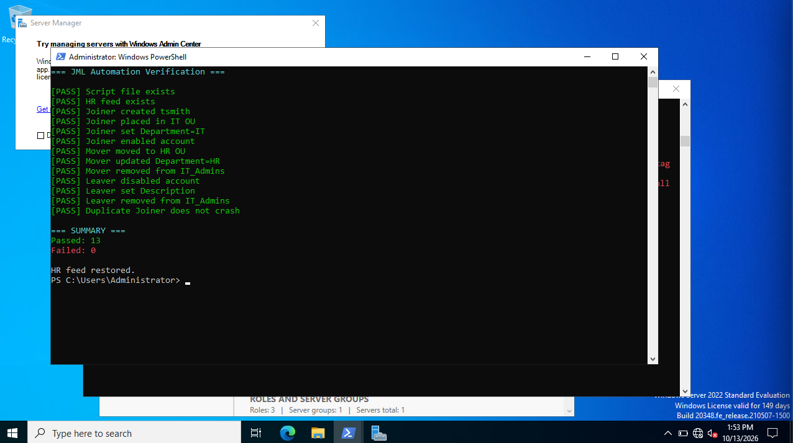

## Automated Verification

Script: `Verify-JML.ps1`

Runs 13 assertions against the live JML script:

- File existence (2)
- Joiner workflow: creation, OU placement, Department attribute, account enabled (4)
- Mover workflow: OU move, Department update, group removal (3)
- Leaver workflow: account disabled, Description stamp, group removal (3)
- Error handling: duplicate Joiner does not crash (1)

Result: 13 passed, 0 failed.

- JML-Automation.ps1 - main automation script
- employees.csv - sample HR feed (in repo)

## Status
Complete. Tested with a 5-row HR feed covering all three JML actions.
